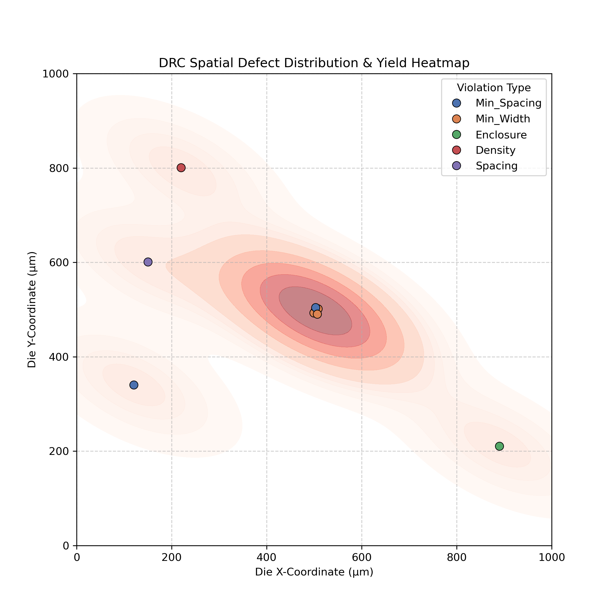

# EDA Yield & Spatial Defect Heatmap Generator

A lightweight, Python-based Electronic Design Automation (EDA) utility designed to parse raw physical design error logs (DRC/LVS) and visualize spatial defect clustering on silicon dies. 

During test-chip tape-outs, reading through thousands of lines of text-based Design Rule Check (DRC) violations is a significant bottleneck. This tool automates log parsing and generates a spatial density heatmap, allowing Process Integration and Layout Engineers to instantly identify systemic layout failures (e.g., routing density issues, CMP vulnerabilities, or lithography focus hot-spots) based on X/Y coordinate clustering.

## Features
* **Automated Log Parsing:** Utilizes `pandas` to extract X/Y coordinates, error types, and layer data from standard EDA output logs (CSV/text format).
* **Spatial Density Visualization:** Leverages `seaborn` and `matplotlib` Kernel Density Estimation (KDE) to overlay a thermal density map on a simulated die area.
* **Defect Categorization:** Plots individual layout violations (e.g., Min_Spacing, Enclosure, Density) with distinct markers for root-cause isolation.

## Example Output
Below is a generated spatial distribution based on a simulated layout error log, successfully isolating a high-density failure zone near the `(500, 500)` coordinate.



## Usage
1. Ensure Python 3.x is installed alongside `pandas`, `matplotlib`, and `seaborn`.
2. Export your Calibre or Assura DRC/LVS error logs to a structured CSV format.
3. Run the generator:
   ```bash
   python3 drc_heatmap.py
